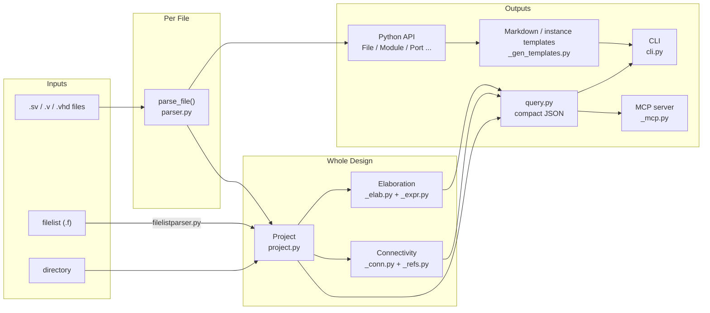
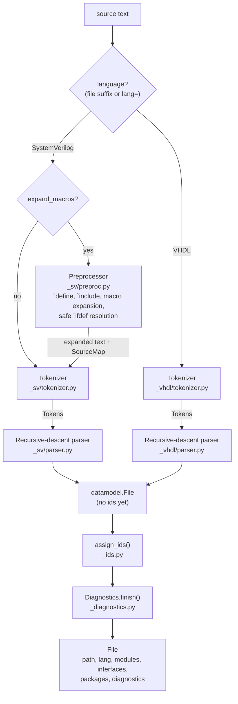
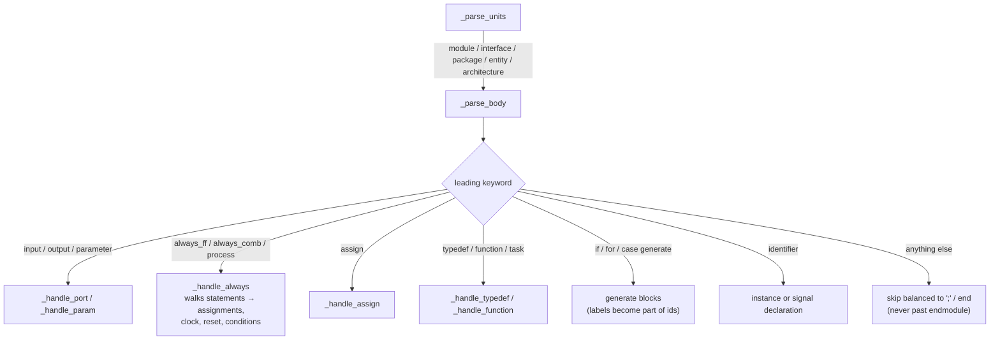
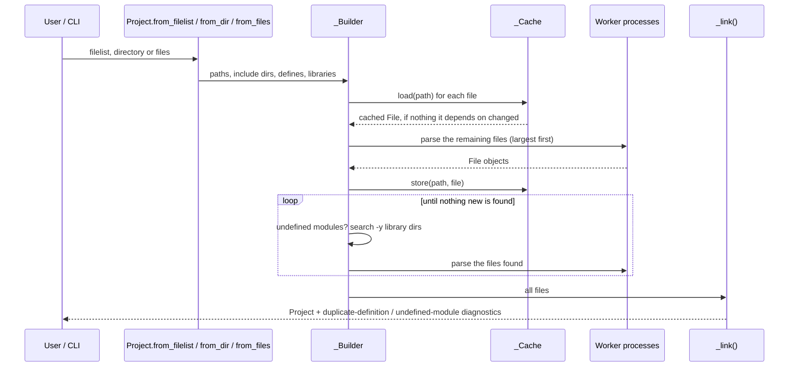
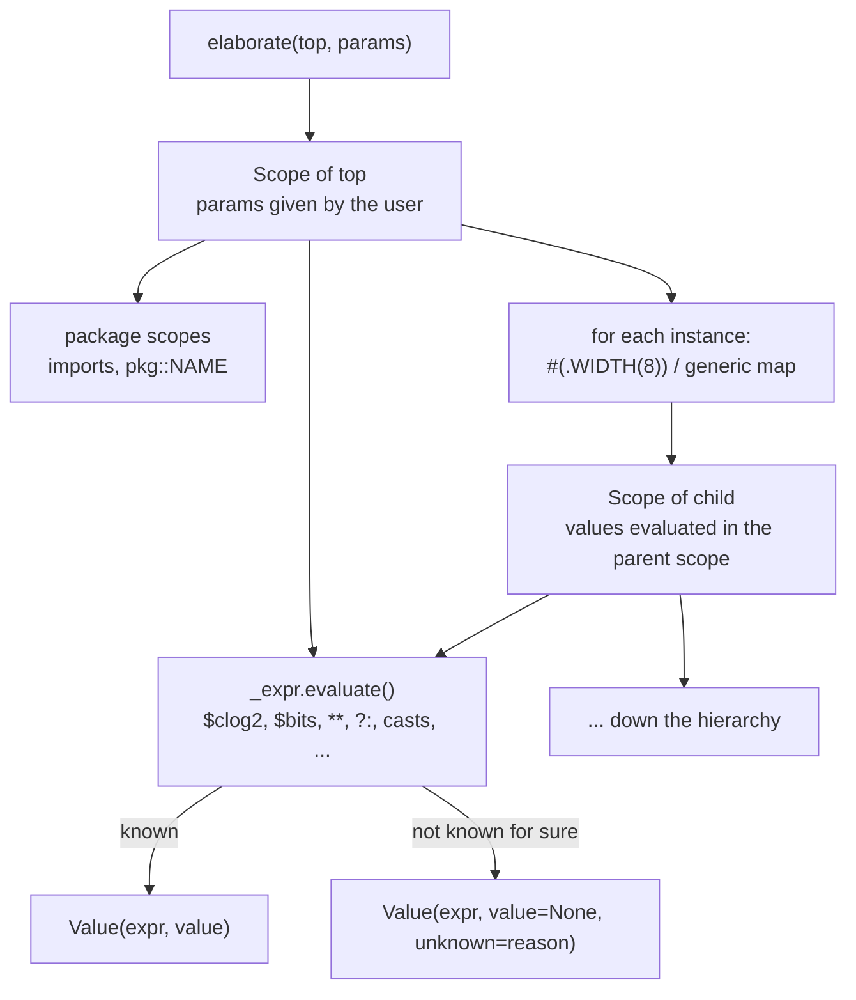
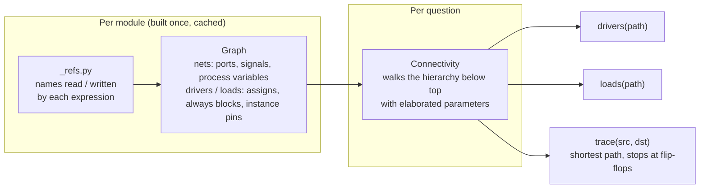
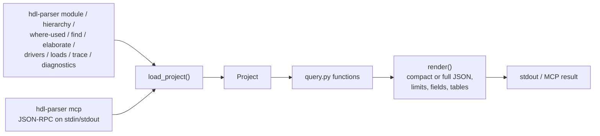

# How It Works

This page explains how hdl-parser turns source files into answers: the stages a file goes through, how a design
becomes a project, and how the queries on top of it work. It is meant for contributors and for anyone who wants
to know what the tool can be trusted with.

## Design Principles

Three rules shape the whole code base:

* **Extract, do not compile.** The parsers understand only the constructs they take information from. Everything
  else is skipped, but always in balanced groups (brackets, `begin`/`end`, `;`), and never beyond the end of a
  module. This keeps the parser small, fast and robust on code it does not fully understand.
* **Never guess.** A value which cannot be determined for sure stays unknown, with the reason. A clock which is
  not written in the code is empty.
* **Problems are data.** Every problem becomes a [Diagnostic][hdl_parser.datamodel.Diagnostic] with a code and a
  location. One bad file never stops the others.

## The Big Picture

There are two levels:

1. **File level** — [parse_file][hdl_parser.parser.parse_file] / [parse_text][hdl_parser.parser.parse_text] turn
   one file into a [File][hdl_parser.datamodel.File]: modules, interfaces, packages and everything within them.
   Files know nothing about each other.
2. **Project level** — a [Project][hdl_parser.project.Project] holds the `File`s of a whole design and links them:
   which module is defined where, who instantiates whom, the value of every parameter per instance, and what
   drives each signal.

## Parsing One File

The entry point is `parse_text()` in `parser.py`. It picks the language, runs the language specific front end,
assigns identifiers and attaches the diagnostics.

### 1. Preprocessor (SystemVerilog, optional)

Macros are **not** expanded by default: most tools only need the declarations, and the code as written is what
users want to see. With `expand_macros=True`, `_sv/preproc.py` runs once over the text, from top to bottom:

* `` `define `` / `` `undef `` update a table of known macros (object-like and function-like, default arguments,
  token pasting, stringification, nesting).
* `` `include `` files are read to learn their macros. Their code is **not** inserted.
* Known macros are replaced everywhere except in comments and strings.
* `` `ifdef `` conditions are resolved only when it is safe: a macro whose definition has been seen **is**
  defined, but a macro which has not been seen may still come from the command line of the simulator. Unknown
  conditions are left alone.

The preprocessor also produces a `SourceMap`, which translates positions in the expanded text back to the original
file. That is why code created by a macro still points to the right line, and names the macro it came from.

### 2. Tokenizer

The tokenizers (`_sv/tokenizer.py`, `_vhdl/tokenizer.py`) know nothing about grammar. They split the text into a
flat list of `Token`s (`_tokens.py`), each one classified as identifier, keyword, number, string, macro or
punctuation, and:

* move comments out of the token stream, but remember which token they belong to — this is how the comment next
  to a port becomes its description;
* (SystemVerilog) resolve the `` `ifdef `` nesting, so **every token knows the conditions it is compiled under**.
  Items in `` `ifdef `` branches are therefore all extracted, each one tagged with its `ifdefs`.

VHDL is case insensitive: keywords are lower case, everything else is kept as written.

### 3. Parser

Both parsers are hand written **recursive-descent parsers** reading the tokens through a `Cursor`. The cursor
hands collected comments to the declaration being parsed, and refuses to skip past *hard stops* such as
`endmodule`, so a construct the parser does not understand can never swallow the rest of the file.

Module items are dispatched by their leading keyword to a handler registered with the `_handles` decorator.
Supporting a new construct usually means adding one handler or one branch in a `_parse_*` function.

The parsers collect light-weight internal records (`_Module`, `_Decl`, `_Inst`, ...) and convert them at the end
into the immutable Pydantic models of `datamodel.py`. VHDL is mapped onto the same model: an entity becomes a
module, generics become parameters, the instances and processes of its architectures are added to that module.

### 4. Identifiers and Diagnostics

`assign_ids()` (`_ids.py`) gives every item a stable, hierarchical `id` built from names only — `top.u_sub.clk`,
`bus_pkg.req_t.addr`, `top.g_a.data` — so it does not change on unrelated edits. Within a project the file is
added: `rtl/top.sv:top.u_sub`.

Every stage reports problems to one `Diagnostics` object (`_diagnostics.py`), e.g. `macro-not-expanded`,
`statement-skipped`, `include-not-found`. They end up in `File.diagnostics`, sorted by position.

## Building a Project

* **Inputs.** `filelistparser.py` reads filelists: files, nested `-f`, `+incdir+`, `+define+`, `-v` library files
  and `-y` library directories with `+libext+`. `from_dir` collects all HDL files below a directory.
* **Parallel parsing.** Files are parsed by a process pool (`jobs`, one per CPU on the command line), largest first
  to balance the load. If processes are not available (sandbox), it silently falls back to one.
* **Cache.** With `cache=True`, the `File` of every source is stored as JSON in `.hdl_parser_cache`. An entry is
  reused only if the file, every file it includes, the parse settings and the parser version are unchanged.
* **Library search.** Modules which are instantiated but not defined are looked up in the `-y` directories, which
  may define further modules — so this repeats until nothing new is found.
* **Linking.** `_link()` looks at all files at once and reports `duplicate-definition` and `undefined-module`.

The project then builds indices **lazily**, on first use: modules and packages by name, instances by module
(`where_used`), and the hierarchy.

## Elaboration: Values of Parameters

`_elab.py` creates a `Scope` per instance: the parameters with the values given by the instance, the local
parameters, enum members and imported packages. `_expr.py` is a small, separate expression evaluator for
SystemVerilog and VHDL constant expressions. Whenever it meets something it cannot evaluate for sure — a function
call, an `x`, an unknown name — it raises `Unknown` with the reason, which becomes the `unknown` field of the
`Value`. Port widths are evaluated the same way, from their dimensions and types.

## Connectivity: Drivers, Loads and Trace

* Each module gets one `Graph`: its nets and the statements that drive and load them. `_refs.py` tells which names
  an expression reads and which names an assignment writes, ignoring struct members, package items, casts,
  attributes and function names.
* `Connectivity` walks the hierarchy below a top with the elaborated parameter values, so generate branches whose
  condition is false are left out and labeled `for` generates are unrolled (`top.g_st[1].data`).
* A signal is addressed by its instance path: `top.u_core.u_alu.result_o`. Moving between levels goes through
  instance pins.
* `trace` searches the shortest connection with a priority queue (Dijkstra). It stops behind flip-flops unless
  `through_regs` is set, and passes through buffer-like cells (`passthrough`, or technology-cell wrappers).
* The granularity is the whole signal: a bit select is kept as text, not split.

## Queries, CLI and MCP Server

`query.py` is the single place where questions are answered as JSON-compatible dicts. The command line and the MCP
server are thin layers over it, so both always give the same answers. `render()` makes the answers small for AI
agents: identifiers relative to their parent, lists of objects as tables, a default limit of 100 entries with
`omitted`/`total` counts, and `--fields`/`--summary` to select less. Errors are structured too (`not-found` with
suggestions, `bad-argument`) and map to stable exit codes.

The MCP server (`_mcp.py`) is a dependency-free implementation of the Model Context Protocol. It keeps the project
in memory and re-reads files that changed before each call.

The older single-file commands (`info`, `json`, `gen-sv-instance`) work directly on `parse_file()` results and
render them with Jinja2 templates (`gen-sv-instance`) or Markdown tables (`info`).

## Source Map

| Module | Role |
| ------ | ---- |
| `parser.py` | Public entry points: `parse_file`, `parse_text`, `parse_defines` |
| `_sv/preproc.py` | Lightweight SystemVerilog preprocessor |
| `_sv/tokenizer.py`, `_vhdl/tokenizer.py` | Tokenizers |
| `_tokens.py` | `Token`, `Tokens`, `Cursor`, `SourceMap` (language independent) |
| `_sv/parser.py`, `_vhdl/parser.py` | Recursive-descent parsers |
| `datamodel.py` | Pydantic models: `File`, `Module`, `Port`, `Param`, `ModuleInstance`, ... |
| `_ids.py` | Stable hierarchical identifiers |
| `_diagnostics.py` | Collection of problems |
| `filelistparser.py` | Filelists (`-f`, `+incdir+`, `+define+`, `-v`, `-y`) |
| `project.py` | `Project`: building, caching, linking, hierarchy, where-used |
| `_expr.py` | Constant expression evaluator |
| `_elab.py` | Parameter values and port widths per instance |
| `_refs.py` | Names read and written by expressions |
| `_conn.py` | Net graphs, drivers, loads, trace |
| `query.py` | Queries with compact JSON answers |
| `cli.py` | Command line interface (Click) |
| `_mcp.py` | MCP server |
| `_gen_templates.py`, `Templates/` | Instance templates and Markdown output |

## Testing

The behaviour above is pinned down by:

* unit tests per construct (`tests/test_*.py`), with reference outputs in `tests/refdata`;
* a **corpus** of unmodified real-world designs (`tests/corpus`: Ibex, OpenTitan, PULP `common_cells` and AXI,
  NEORV32, Microwatt, PoC, SURF, Potato), snapshot-tested and checked against structural invariants;
* the code examples in this documentation, which are run as doctests.
